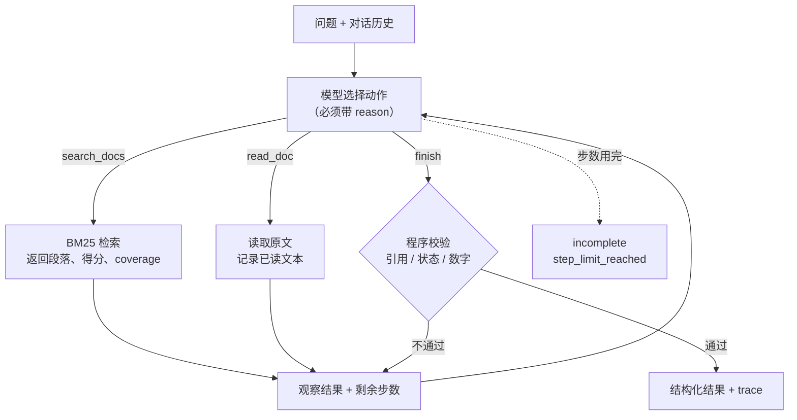

# 02 方案：调用流程、动态决策和技术取舍

## 调用流程

代码位置：

| 模块 | 职责 |
|---|---|
| [src/kb_agent/agent.py](../src/kb_agent/agent.py) | 决策循环、步数和工具调用次数上限、`finish` 校验 |
| [src/kb_agent/tools.py](../src/kb_agent/tools.py) | `search_docs` / `read_doc` 和它们的 JSON Schema、故障注入、已读原文登记 |
| [src/kb_agent/retrieval.py](../src/kb_agent/retrieval.py) | 中文字二元组 + BM25、加权 coverage |
| [src/kb_agent/docs.py](../src/kb_agent/docs.py) | 读取 Markdown 文档、叠加和移除文档 |
| [src/kb_agent/prompts.py](../src/kb_agent/prompts.py) | 系统提示词（决策规则） |
| [src/kb_agent/llm/openai_compat.py](../src/kb_agent/llm/openai_compat.py) | OpenAI 兼容接口（DeepSeek、通义千问） |
| [src/kb_agent/llm/mock.py](../src/kb_agent/llm/mock.py) | 离线 Mock |
| [src/kb_agent/cases.py](../src/kb_agent/cases.py)、[trace.py](../src/kb_agent/trace.py) | 批量运行用例、检查预期、生成运行记录 |

## 动态决策：谁决定什么

**每一步做什么由模型决定。** 程序只做三件事：执行模型选的工具；把结果（含错误）原样作为观察返回给模型；`finish` 不合格时退回并说明原因。程序里没有"检索完就读第一篇"或"失败就重试"之类的分支。

模型要根据观察结果做的选择：

| 观察到的结果 | 可选动作 | 题目对应 |
|---|---|---|
| 检索为空，或 coverage 很低、命中的都是"申请""公司"这类常见词 | 改写关键词再检索；或判定资料外，返回 `insufficient_evidence` | 资料外问题、改写问题、检索改进 |
| 检索命中多份文档 | 逐份 `read_doc` 读原文 | 读取原文 |
| 原文对同一事项规定不同 | 在原文中找适用范围或优先级条款：有就分别作答，没有就返回 `conflict_needs_confirmation` 并追问 | 文档冲突、查证 |
| 工具返回 `TOOL_UNAVAILABLE` | 重试；或停下返回 `tool_error` | 工具失败 |
| `finish` 被退回（引用不是原文、缺第二份文档、数字没有依据） | 补读原文、修正引用后重新提交 | 无依据回答红线 |
| 当前问题是"那……呢"，或用户在历史中指定了某份制度 | 结合历史重写检索词，按用户确认的制度回答 | 上下文追问 |
| 剩余步数不多 | 用已有信息调用 `finish` | 步数上限 |

每次工具调用都带一个 `reason` 参数，模型用一句话说明为什么选这一步。它会原样写进 trace 的"决策依据"列，满足"简要决策依据"的要求，又不需要暴露模型内部的思考过程。

## 程序强制的校验

`finish` 由 [`check_finish`](../src/kb_agent/agent.py) 校验，不通过的原因会作为观察返回给模型，模型可以修正后再交：

1. **引用必须是本轮读过的原文。** `doc_id` 必须存在，`quote` 必须是本轮 `read_doc` 返回文本的连续片段（比较前做 NFKC 归一化、去掉空白）。检索片段不能直接引用，这样模型必须读到全文，才有机会看到适用范围之类的条款。
2. **状态要满足对应条件。**
   - `answered`：至少 1 条有效引用。
   - `conflict_needs_confirmation`：引用至少 2 份不同文档，要有确认问题，而且确认问题里要列出每份所引文档的 ID 或标题（v2）。
   - `need_clarification`：要有追问。
   - `insufficient_evidence` / `tool_error`：`gaps` 非空，并且**不能附带引用**（v2）。能引用就说明至少能回答一部分，应改用 `answered`，把缺失部分写进 `gaps`。
3. **数字要有依据。** `answer` 里出现的阿拉伯数字必须能在引用原文、用户问题、对话历史或所引文档的版本日期中找到。这样可以拦住"45 天""效率提升 80%"这类没有出处的数字，也会拦住推导出的数字（如原文写"不享受"，答案写成"0 天"）。
   以下结构性编号不参与校验，都是在真实运行中发现后逐步排除的：
   - 文档和段落编号：D01、D01-S2、S2；
   - 条款引用："第 2 条""第 1 节"；
   - 列表序号：行首或标点、空白后的"1.""2、"，以及圆圈序号 ①②。
   模型把换行写成字面 `\n` 时，校验前会还原成换行；展示给用户的答案也做同样还原。

   **中文数字（v2.3）**：后面紧跟数量单位（天、年、个月、个工作日、小时、元、位……）的中文数字会先换算成阿拉伯数字，问题、引用和答案三方都按同一规则换算。所以问题里的"满三年"可以作为答案中"3 年"的依据，答案里写"四十五天"也会被检查。不带单位的写法不换算，例如"一般""两份文档""分三档""第三条"，否则冲突回答里常见的"两份文档"会被误判。
4. **有上限。**
   - 每轮最多 `max_steps` 次模型调用（默认 8）；用完返回 `incomplete` / `step_limit_reached`，并列出已读文档。
   - 每轮最多 `max_tool_calls` 次业务工具调用（默认 12）；超出后返回 `TOOL_BUDGET_EXHAUSTED`，让模型收尾。
5. **协议错误也作为观察返回。** 模型直接输出文字时，提醒它通过工具推进；参数不是合法 JSON 时，返回 `INVALID_ARGUMENTS`。这些都计入步数。

一步就是一次模型调用。模型可以在一步内并行发起多个工具调用（DeepSeek 常在第一步同时发出两个检索），每个调用都单独执行、单独写进 trace、单独计入工具调用次数。所以 trace 里可能出现两行相同的步号。

冲突本身由模型判断，程序不检测：程序无法通用地知道两段话是否在讲同一件事。程序能保证的是：一旦报冲突，就必须拿出两份文档的原文。

### v2 新增的决策规则（提示词）

这些规则来自 v1 真实运行中暴露的问题，决策过程见 [04-ai-usage.md](04-ai-usage.md#v2-改进的决策)：

| 规则 | 针对的 v1 问题 | 程序是否校验 |
|---|---|---|
| 部分可答用 `answered`，缺失部分写进 `gaps`；`insufficient_evidence` 只用于完全没有依据 | C07 在两种状态间摇摆 | 是：`insufficient_evidence` / `tool_error` 不能带引用 |
| 同一工具连续 2 次 `TOOL_UNAVAILABLE` 就停止，返回 `tool_error` | C09 重试了 5 次 | 否：重试仍由模型决定 |
| 冲突追问要列出可选的制度，不加入原文没有的推测 | C04 第 1 轮的追问夹带推测 | 部分：程序检查是否列出每份所引文档 |
| 同一事项按条件分档不是冲突 | 没有反例用例 | 否，用 C13 验证 |
| 回答第一句给结论，补充最多一条；引用回答中实际用到的原文，不引用没用到的段落（v2.1 修正后的写法） | 回答平均约 230 字，平均 2.6 条引用 | 否，用汇总中的回答字数和引用数衡量 |

## 工具设计

| 工具 | 参数 | 返回 |
|---|---|---|
| `search_docs` | `query`、`top_k`（1–8）、`reason` | 段落列表：`doc_id`、标题、`version_date`、`section_id`、片段、BM25 得分、`coverage`、命中词 |
| `read_doc` | `doc_id`、可选 `section_id`、`reason` | 文档元数据和段落原文；默认返回全文，方便看到适用范围 |
| `finish` | `status`、`answer`、`citations[{doc_id, quote}]`、`gaps`、`clarification_question`、`reason` | 通过 / 退回原因 |

- 工具从不抛异常，故障、参数错误、文档不存在都以 `{"ok": false, "error_code": ...}` 返回。这样"失败怎么办"始终由模型决定。
- 故障注入格式是 `--fail <工具>:<once|always|N>`，`*` 表示所有工具。

## 技术取舍

| 选择 | 原因 | 放弃了什么 |
|---|---|---|
| **原生实现循环，不用 LangGraph / AgentScope** | 循环只有约 100 行，校验、上限、trace 都写在明处，评审能直接对照代码；测试可以用脚本化的假模型逐步驱动 | 没有现成的状态持久化和可视化；以后要做多 Agent 或断点续跑，再引入框架更合适 |
| **BM25 + 中文字二元组，不用向量检索** | 不需要下载模型、离线可跑、结果可解释（能看到命中了哪些词）。字面检索的盲区（"WFH"对应"远程办公"）正好留给模型改写查询，这本身就是题目要的"检索改进" | 同义词召回弱。真实知识库规模大了以后，应换成"向量 + BM25"混合检索 |
| **`coverage`（按词稀有度加权的覆盖率）** | 原始 BM25 分数在不同查询之间没法比较。coverage 让模型和 Mock 都能判断"命中的只是常见词" | 多一个字段，模型可能过度依赖它 |
| **引用必须来自 `read_doc`** | 防止只看片段就作答，漏掉适用范围条款（C12 就是这种情况） | 每篇文档多一次工具调用 |
| **OpenAI 兼容接口** | 一个适配器同时支持 DeepSeek、通义千问，以及本地 Ollama（兼容模式）。使用 `tool_choice="auto"` + `temperature=0`，并在提示词中要求每步调用工具，因为各家对 `required` 的支持不一致 | 没有用各家的专有功能 |
| **离线 Mock 是读观察结果的启发式策略** | 评审没有 key 也能跑通完整链路；替换文档后 Mock 的答案也会跟着变，不是写死的回放 | Mock 的决策是人写的规则，**不证明真实模型的决策效果**。它做不了语义改写（C07），也读不懂适用范围（C12） |

## 离线 Mock 的边界

[`MockLLM`](../src/kb_agent/llm/mock.py) 与真实模型走同一个接口、看同样的消息。它的行为：

0. 问题以"这个""那笔"等指代词开头、又没有对话历史时，直接追问（`need_clarification`）。
1. 第一次先检索；问题以"那……"开头、以"呢"结尾时，把上一轮问题拼进检索词。
2. 某个段落的 coverage 同时满足"不低于 0.15"和"不低于最高分的一半"，才算相关。都不相关就去掉疑问词再检索一次，仍不相关就返回 `insufficient_evidence`。
3. 依次读取相关文档。若不同文档对同一单位（天、元、年……）给出不同数值，返回冲突；否则引用排名最高文档的前两个相关段落作答。
4. 工具出现 `TOOL_UNAVAILABLE` 时重试一次，连续两次失败就返回 `tool_error`。

这些规则只用来证明流程能跑通（工具、校验、trace、上限），不用来证明决策质量。
